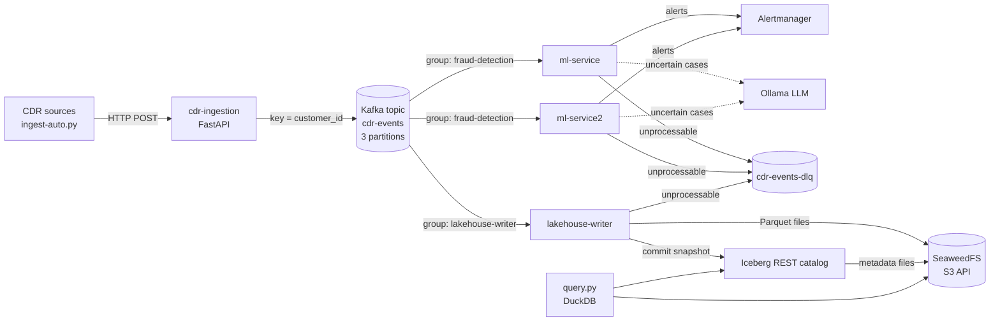

# Architecture: Telecom CDR Streaming Lakehouse

This document describes how call detail records (CDRs) move through the system, why it is built this way, and what would change to run it in production.

The project started as a University of Oulu group project that used RabbitMQ for fraud detection. Version 2 replaces the queue with Kafka and adds an Apache Iceberg lakehouse, so the same event stream serves real-time fraud detection and historical analytics.

## Contents

- [System overview](#system-overview)
- [Components](#components)
- [Data flow](#data-flow)
- [Design decisions](#design-decisions)
- [Delivery guarantees](#delivery-guarantees)
- [Failure scenarios](#failure-scenarios)
- [Data model](#data-model)
- [Known limitations](#known-limitations)
- [Path to production](#path-to-production)
- [Running and verifying](#running-and-verifying)

## System overview



One topic, two independent consumer groups. Fraud detection and the lakehouse each read every CDR at their own pace, and neither can slow down or block the other.

## Components

| Component | Technology | Role |
|---|---|---|
| `cdr-ingestion` | Python, FastAPI, `confluent-kafka` | Validates and enriches CDRs received over HTTP, publishes them to Kafka |
| `kafka` | Apache Kafka 3.9.1, KRaft mode | Durable, ordered, replayable event log |
| `kafka-init` | One-shot container | Creates `cdr-events` (3 partitions) and `cdr-events-dlq` (1 partition); automatic topic creation is disabled |
| `ml-service`, `ml-service2` | Python, scikit-learn, Ollama | Fraud detection: rules, then a random forest, then an LLM for uncertain cases |
| `lakehouse-writer` | Python, PyIceberg, PyArrow | Streams CDRs into the Iceberg table `telecom.cdr_events` |
| `iceberg-rest` | Apache Iceberg REST catalog 1.9.1 | Tracks the current metadata file of each table; state kept in SQLite on a volume |
| `seaweedfs` | SeaweedFS 4.51 | S3-compatible object storage for Parquet data and Iceberg metadata |
| `query.py` | DuckDB | Analytical (OLAP) queries and snapshot time travel |
| Prometheus, Grafana, Alertmanager | | Metrics, dashboards and fraud alerts |

## Data flow

1. **Ingest.** A client posts a CDR to `/ingest` or `/ingest/batch`. The service validates it, adds `processed_timestamp` and simple risk flags, and produces it to `cdr-events` with `customer_id` as the key.
2. **Partition.** Kafka hashes the key, so all CDRs of one customer land in the same partition, in the order they were produced.
3. **Detect fraud.** The `fraud-detection` group splits the 3 partitions between the two `ml-service` replicas. Each CDR goes through rules, a random forest score, and the LLM if the score is uncertain. Fraud raises an alert in Alertmanager.
4. **Write to the lakehouse.** The `lakehouse-writer` group reads the same partitions independently. It buffers rows and appends a batch to Iceberg every 500 rows or 10 seconds. Each append creates a new snapshot.
5. **Analyse.** `query.py` loads the current snapshot (or an earlier one) and runs SQL with DuckDB.

## Design decisions

### Kafka instead of RabbitMQ

RabbitMQ deletes a message once it is acknowledged. That fits a task queue with a single consumer, which is what the original system was. Version 2 needs the same events to feed two systems, and to be re-read after a fraud rule changes or a model is retrained. Kafka keeps messages after they are read, so any number of consumer groups can read the same data, and a group can rewind to replay history.

The migration ran in stages, so the system kept working at every commit:

1. Run Kafka next to RabbitMQ.
2. Dual-write: ingestion publishes to both.
3. Move fraud detection to Kafka.
4. Remove RabbitMQ.

### Partition key: `customer_id`

Fraud patterns are per customer: a SIM swap followed by large payments, or many transactions in a short window. Keying by `customer_id` keeps each customer's CDRs in order inside one partition and sends them to the same consumer.

Trade-off: **key skew**. Customers with more activity make some partitions bigger. In the test data, partitions hold 248, 328 and 224 messages. With real traffic, a few very active subscribers could overload one partition; the usual answers are more partitions or a composite key.

### KRaft, and why there is one broker

KRaft lets Kafka manage its own cluster metadata, without a separate ZooKeeper cluster. One broker with replication factor 1 keeps the local stack light. It is not fault tolerant; see [Path to production](#path-to-production).

### Explicit topic creation

`KAFKA_AUTO_CREATE_TOPICS_ENABLE=false`, and `kafka-init` creates topics with chosen partition counts. A typo in a topic name then fails loudly instead of silently creating a new, empty topic.

### At-least-once for fraud detection

The ML consumer uses `enable.auto.offset.store=false` and stores a message's offset only after processing finishes. If a replica crashes mid-message, the message is processed again rather than skipped. Missing a fraud case is worse than checking a CDR twice.

### Exactly-once into Iceberg

Kafka offsets and Iceberg data live in different systems, so committing them separately leaves a gap: a crash after the Iceberg commit but before the Kafka commit would write the same rows twice on restart.

The writer closes that gap by storing the offsets **inside the Iceberg commit**, as the snapshot property `kafka.cdr-events.offsets`. Data and position are committed atomically. When partitions are assigned, the writer reads that property and seeks there, ignoring Kafka's own committed offsets. It then commits the same offsets back to Kafka, only so that consumer lag reports correctly.

This was tested by rewinding the writer's Kafka offsets to 0 and restarting it: it resumed at offsets 248, 328 and 225 from Iceberg and wrote no duplicates.

### Batched appends

Every Iceberg append writes new Parquet files and a new snapshot. Writing one row per append would create thousands of tiny files and slow down every query. The writer batches up to 500 rows or 10 seconds, trading a little latency for far fewer files.

### Dead-letter topic

A message that cannot be parsed or processed goes to `cdr-events-dlq`, with headers for the error, the source partition and the source offset. The consumer then moves on, so one bad message cannot block a whole partition, and nothing is silently dropped.

### Iceberg as the table format

Iceberg gives the lakehouse database-like guarantees on plain files in object storage: atomic commits, schema evolution, hidden partitioning, and time travel to earlier snapshots. It is an open format, so the same table can be read by DuckDB, Trino, Spark or Flink without copying data.

The table is partitioned by `day(time_stamp)`, so queries filtered by date skip files for other days.

### SeaweedFS for object storage

Any S3-compatible store works, because Iceberg only talks to the S3 API. MinIO was the first choice, but its Docker images are no longer published. SeaweedFS is Apache-licensed, runs as a single container, and is a drop-in replacement for local development. In the cloud this would be Amazon S3 or an equivalent.

## Delivery guarantees

| Path | Guarantee | How |
|---|---|---|
| Producer → Kafka | No duplicates or reordering from retries | `enable.idempotence=true`, `acks=all` |
| Kafka → fraud detection | At least once | Offset stored only after processing |
| Kafka → Iceberg | Exactly once | Offsets committed in the same Iceberg snapshot as the data |
| HTTP client → Kafka | **At most once** (see limitations) | `produce()` is asynchronous; the API answers before the broker confirms |

## Failure scenarios

| Failure | What happens |
|---|---|
| An `ml-service` replica stops | It leaves the group; Kafka moves its partitions to the other replica within seconds. Tested: one replica held all 3 partitions until the second joined, then they were rebalanced. |
| A malformed message | Sent to `cdr-events-dlq` with the error; processing continues. Tested with a non-JSON message. |
| `lakehouse-writer` crashes mid-batch | Unflushed rows were never committed to Iceberg, so on restart it reads them again from the last stored offsets. No loss, no duplicates. |
| Kafka offsets lost or rewound | The writer ignores them and resumes from Iceberg. Tested by resetting the group to offset 0. |
| Ollama unavailable | Uncertain cases fall back to the random forest score. |
| The Kafka broker stops | Producers buffer, then fail; consumers wait. With one broker this is an outage; replication would prevent it. |

## Data model

Iceberg table `telecom.cdr_events`, partitioned by `day(time_stamp)`:

| Column | Type | Notes |
|---|---|---|
| `transaction_id` | string | Unique per CDR |
| `customer_id` | string | Kafka key |
| `full_name`, `city`, `mobile_number` | string | |
| `sim_serial_number`, `sim_status`, `imei` | string | |
| `risk_score` | double | 0.0 to 1.0 |
| `fraud_flag` | boolean | |
| `fraud_type` | string | e.g. `SIM_SWAP`, `IMEI_CLONE`, `ROAMING_ABUSE` |
| `type` | string | Transaction type |
| `amount_eur` | double | |
| `time_stamp` | timestamptz | Event time, used for partitioning |
| `processed_timestamp` | timestamptz | Set by ingestion |
| `kafka_partition`, `kafka_offset` | int, long | Lineage: where each row came from |
| `ingested_at` | timestamptz | When the writer read it |

## Known limitations

- **The HTTP API can lose a CDR.** `/ingest` returns `202 Accepted` before Kafka confirms the write, and logs publish failures instead of returning an error. A broker outage at that moment loses the record. Fix: wait for the delivery report (or `flush`) before responding, and return `503` on failure.
- **Duplicate fraud alerts on replay.** At-least-once processing means a reprocessed CDR can raise its alert twice. Fix: use `transaction_id` as an idempotency key where alerts are stored.
- **The random forest is trained per replica, in memory.** Each replica only sees its own partitions, and the model is lost on restart. A shared model registry and offline training from the lakehouse would fix both.
- **One lakehouse writer.** The offset merge assumes a single writer. Two replicas would need to handle Iceberg commit conflicts, or write per-partition.
- **No table maintenance.** Small files and old snapshots accumulate. Compaction and snapshot expiry need to run on a schedule.
- **Test-grade catalog.** `iceberg-rest-fixture` is the reference implementation, with SQLite storage and no authentication.
- **No schema contract.** Producers and consumers agree on JSON fields informally; a breaking change would only show up as DLQ messages.
- **DuckDB loads the snapshot into memory.** Fine for this data volume, not for large tables.

## Path to production

| Area | Local setup | Production |
|---|---|---|
| Kafka | 1 broker, replication factor 1 | 3+ brokers, replication factor 3, `min.insync.replicas=2`, rack awareness |
| Schemas | Informal JSON | Avro or Protobuf with a schema registry and compatibility rules |
| Catalog | `iceberg-rest-fixture`, SQLite | Apache Polaris, Lakekeeper or Nessie, backed by Postgres, with access control |
| Storage | SeaweedFS, one container | S3 or equivalent, with lifecycle rules |
| Query engine | DuckDB, in memory | Trino or Spark for large scans; DuckDB for local analysis |
| Lakehouse writes | Python writer | Kafka Connect Iceberg sink or Flink, for higher throughput |
| Table maintenance | None | Scheduled compaction, snapshot expiry and orphan file cleanup |
| OLTP | Postgres disabled | Postgres for fraud alerts and case handling (fast single-row reads and updates) |
| Monitoring | Prometheus, Alertmanager | Plus consumer lag alerts per group, DLQ rate, and writer commit latency |
| Deployment | Docker Compose | Kubernetes, with Kafka run by an operator such as Strimzi |
| Secrets | Defaults in Compose | A secret manager; no defaults outside local development |

## Running and verifying

From `fraud-detection-system/`:

```bash
# Start the pipeline
docker compose -f docker-compose.system.yml up -d --build cdr-ingestion ml-service ml-service2 lakehouse-writer

# Send the sample dataset (800 CDRs)
python ingest-auto/ingest-auto.py --batch-size 50

# Consumer lag for both groups (LAG should reach 0)
docker exec kafka_1 /opt/kafka/bin/kafka-consumer-groups.sh --bootstrap-server localhost:9092 --describe --all-groups

# Query the lakehouse: row counts, duplicates, fraud by type, time travel
docker compose -f docker-compose.system.yml run --rm --no-deps lakehouse-writer python query.py
```
