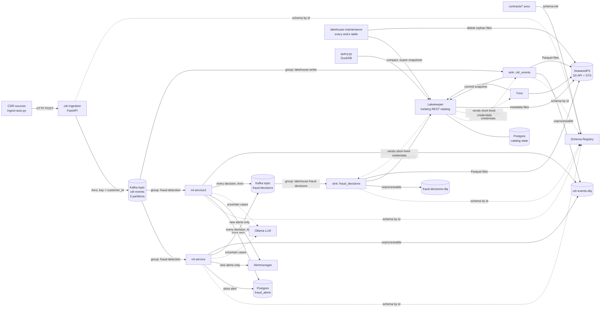

# Architecture: Telecom CDR Streaming Lakehouse

This document describes how call detail records (CDRs) move through the system, why it is built this way, and what would change to run it in production.

The project started as a University of Oulu group project that used RabbitMQ for fraud detection. Version 2 replaces the queue with Kafka and adds an Apache Iceberg lakehouse, so the same event stream serves real-time fraud detection and historical analytics.

The streaming and lakehouse parts are built as a small platform that other services build on: every topic has an Avro data contract in a schema registry, a shared client library encodes and decodes messages, and topics land in Iceberg through sinks defined in configuration. Adding a dataset takes a contract, a sink file and a deployment entry, not code ([onboarding guide](onboarding-a-dataset.md)).

## Contents

- [System overview](#system-overview)
- [Components](#components)
- [Data flow](#data-flow)
- [Design decisions](#design-decisions)
- [Delivery guarantees](#delivery-guarantees)
- [Failure scenarios](#failure-scenarios)
- [Performance](#performance)
- [Monitoring](#monitoring)
- [Data model](#data-model)
- [Known limitations](#known-limitations)
- [Path to production](#path-to-production)
- [Running and verifying](#running-and-verifying)

## System overview



One topic, two independent consumer groups. Fraud detection and the lakehouse each read every CDR at their own pace, and neither can slow down or block the other. Fraud detection in turn publishes its decisions as events, which a second sink lands in the lakehouse next to the CDRs.

## Components

| Component | Technology | Role |
|---|---|---|
| `cdr-ingestion` | Python, FastAPI, `confluent-kafka` | Validates and enriches CDRs received over HTTP, publishes them to Kafka as Avro |
| `kafka` | Apache Kafka 3.9.1, KRaft mode | Durable, ordered, replayable event log |
| `kafka-init` | One-shot container | Creates `cdr-events` and `fraud-decisions` (3 partitions each) and their dead-letter topics (1 partition each); automatic topic creation is disabled |
| `schema-registry` | Confluent Schema Registry 7.9.1 | Stores each topic's Avro schema versions (in the `_schemas` topic) and enforces their compatibility rule |
| `schema-init` | One-shot container | Registers the contracts in [`contracts/`](../fraud-detection-system/contracts/); fails, and stops dependent services from starting, if one breaks its compatibility rule |
| `libs/dataplatform` | Python library | Shared by every producer and consumer: Avro encoding with registered schemas only, decoding by schema id, the contracts job, and an in-memory registry for tests |
| `ml-service`, `ml-service2` | Python, scikit-learn, Ollama | Fraud detection: rules, then a random forest, then an LLM for uncertain cases. Publishes every decision to `fraud-decisions`, and serves the alerts API (`/alerts`) |
| `postgres` | PostgreSQL 15 | OLTP store for fraud alerts and their case status; schema in `postgres/init/` |
| `lakehouse-writer`, `lakehouse-writer-fraud-decisions` | Python, PyIceberg, PyArrow | One process per sink in [`lakehouse/sinks/`](../fraud-detection-system/lakehouse/sinks/): streams a topic into an Iceberg table (`telecom.cdr_events`, `telecom.fraud_decisions`) |
| `lakehouse-maintenance` | Python, PyIceberg | Hourly compaction, snapshot expiry and orphan file cleanup for every sink's table, with each sink's policy |
| `lakekeeper` | Lakekeeper 0.13.8 (Rust) | Iceberg REST catalog: tracks the current metadata file of each table, keeps its state in its own Postgres (`lakekeeper-db`), and vends short-lived storage credentials. `lakekeeper-migrate` and `lakekeeper-init` create its schema and the `lakehouse` warehouse |
| `trino` | Trino 484 | Distributed SQL engine over the lakehouse tables, with no storage keys of its own |
| `seaweedfs` | SeaweedFS 4.51 | S3-compatible object storage for Parquet data and Iceberg metadata |
| `query.py` | DuckDB | Analytical queries in a single process, and snapshot time travel |
| `kafka-exporter` | kafka-exporter 1.9.0 | Consumer lag per group and topic offsets, for Prometheus |
| Prometheus, Grafana, Alertmanager | | Metrics from every service, the provisioned "CDR Pipeline" dashboard, pipeline alerts and fraud alerts |

## Data flow

1. **Ingest.** A client posts a CDR to `/ingest` or `/ingest/batch`. The service validates it, adds `processed_timestamp` and simple risk flags, encodes it with the `cdr-events` contract, and produces it with `customer_id` as the key. It answers only after the broker confirms the write.
2. **Partition.** Kafka hashes the key, so all CDRs of one customer land in the same partition, in the order they were produced.
3. **Detect fraud.** The `fraud-detection` group splits the 3 partitions between the two `ml-service` replicas. Each CDR goes through rules, a random forest score, and the LLM if the score is uncertain. A fraud decision is stored in Postgres; if the row is new, Alertmanager is notified. Analysts list alerts and record decisions (`confirmed`, `dismissed`) through the alerts API. Every decision, fraud or not, is published to `fraud-decisions`.
4. **Write to the lakehouse.** Each sink's writer reads its topic as its own consumer group. It buffers rows and appends a batch to Iceberg every 500 rows or 10 seconds (set in the sink file). Each append creates a new snapshot.
5. **Analyse.** Trino queries the tables through the same catalog, with partition pruning, joins across tables and Iceberg's metadata tables. `query.py` does the same in a single process with DuckDB.

## Design decisions

### Kafka instead of RabbitMQ

RabbitMQ deletes a message once it is acknowledged. That fits a task queue with a single consumer, which is what the original system was. Version 2 needs the same events to feed two systems, and to be re-read after a fraud rule changes or a model is retrained. Kafka keeps messages after they are read, so any number of consumer groups can read the same data, and a group can rewind to replay history.

The migration ran in stages, so the system kept working at every commit:

1. Run Kafka next to RabbitMQ.
2. Dual-write: ingestion publishes to both.
3. Move fraud detection to Kafka.
4. Remove RabbitMQ.

### Partition key: `customer_id`

Fraud patterns are per customer: a SIM swap followed by large payments, or many transactions in a short window. Keying by `customer_id` keeps each customer's CDRs in order inside one partition and sends them to the same consumer.

Trade-off: **key skew**. Customers with more activity make some partitions bigger. In the test data, partitions hold 248, 328 and 224 messages. With real traffic, a few very active subscribers could overload one partition; the usual answers are more partitions or a composite key.

### KRaft, and why there is one broker

KRaft lets Kafka manage its own cluster metadata, without a separate ZooKeeper cluster. One broker with replication factor 1 keeps the local stack light. It is not fault tolerant; see [Path to production](#path-to-production).

### Explicit topic creation

`KAFKA_AUTO_CREATE_TOPICS_ENABLE=false`, and `kafka-init` creates topics with chosen partition counts. A typo in a topic name then fails loudly instead of silently creating a new, empty topic.

### At-least-once for fraud detection

The ML consumer uses `enable.auto.offset.store=false` and stores a message's offset only after processing finishes. If a replica crashes mid-message, the message is processed again rather than skipped. Missing a fraud case is worse than checking a CDR twice.

### Exactly-once into Iceberg

Kafka offsets and Iceberg data live in different systems, so committing them separately leaves a gap: a crash after the Iceberg commit but before the Kafka commit would write the same rows twice on restart.

The writer closes that gap by storing the offsets **inside the Iceberg commit**, as the snapshot property `kafka.<topic>.offsets` (e.g. `kafka.cdr-events.offsets`). Data and position are committed atomically. When partitions are assigned, the writer reads that property and seeks there, ignoring Kafka's own committed offsets. It then commits the same offsets back to Kafka, only so that consumer lag reports correctly.

This was tested by rewinding the writer's Kafka offsets to 0 and restarting it: it resumed at offsets 248, 328 and 225 from Iceberg and wrote no duplicates.

A later test found a gap anyway. With the broker stopped, the writer appended a batch to Iceberg and then blocked on the Kafka offset commit. While it waited, the consumer session timed out, the revoke callback ran `flush()` again, and the batch was still in the buffer, so the same 3 rows were appended twice. The commit then failed and the writer crashed. Two changes closed it:

- The buffer is cleared as soon as the Iceberg append succeeds, before the Kafka commit, and a failed Kafka commit is logged instead of raised. The Kafka commit only feeds lag reporting, so it should never stop the writer.
- Before each append the writer drops rows whose offset is below what Iceberg already stores for that partition. An append is then idempotent against the table's own state, whatever the bug that re-sends it.

Repeating the same broker outage after the fix: the commit failure was logged, the partitions were revoked and reassigned, the writer did not restart, and no new duplicates were written.

**Offsets name their topic.** Offsets only mean something for the topic they were read from. When the local stack's `cdr-events` was deleted and created again, it restarted at offset 0, but the table still held offsets 248, 328 and 242 from the old topic: the writer would have resumed there and silently skipped the new topic's first messages. Each commit now also stores the topic's id (`kafka.<topic>.topic-id`; Kafka gives every topic a unique id when it is created, KIP-516), and compaction carries it forward. On every partition assignment the writer compares it with the live topic's id. If they differ, the stored offsets belong to a topic that no longer exists: the writer reads the new topic from its beginning, without falling back on the consumer group's equally stale committed offsets, logs an error and counts it for the `LakehouseSourceTopicRecreated` alert. Its next commit replaces the old offsets rather than merging with them.

Snapshots written before ids were recorded have offsets without one. For those, an offset past the end of its partition, or a partition that no longer exists, proves the topic was recreated; otherwise the writer adopts the topic and records its id with the next commit. The one case this cannot catch is a topic recreated *and* refilled past the old offsets before the upgrade.

### Data contracts in a schema registry

The first version sent JSON, and producers and consumers agreed on its fields informally. A renamed field or a changed type would only have shown up as messages in a dead-letter topic, after it had already broken the consumers. On a platform that several teams build on, the format of a topic is an interface and needs the same care as an API.

Each topic now has an Avro schema in [`contracts/`](../fraud-detection-system/contracts/), with an owner and a compatibility rule:

- **Registered by a job, never by producers.** `schema-init` runs `python -m dataplatform.contracts apply`, which sets each subject's compatibility level and registers the schema. Producers look their schema up and fail if it is not registered (`auto.register.schemas` off, in effect), so a producer cannot put a new schema on a topic by deploying.
- **`FULL_TRANSITIVE` compatibility.** Every version must read data written with every other version. Producers and consumers can then upgrade in any order, and a sink can read the whole history of its topic. In practice only fields with defaults can be added or removed. `BACKWARD` would allow adding required fields, but then old consumers break while a new producer rolls out.
- **Messages carry the schema id.** The Confluent wire format (a zero byte, a 4-byte schema id, then the Avro body) means each message is decoded with the exact schema it was written with, and any tool that speaks the format can read the topics.
- **A shared client library.** `libs/dataplatform` holds the encoding rules, so services cannot disagree on them. It separates a message that can never be decoded (`InvalidMessage`: dead-letter it) from a temporary problem such as the registry being down (retry, never dead-letter a valid message).

The registry is Confluent Schema Registry, the most widely used implementation of the API. Karapace and Apicurio implement the same API under Apache 2.0 and would be drop-in replacements; the library only uses the client calls they share.

**Migrating from JSON.** Topics already held JSON messages. The decoder still accepts JSON on `cdr-events` (a JSON object starts with `{`, never the zero byte), so the writers and fraud detection read old and new messages side by side, and nothing had to be replayed or converted. Fraud detection turns decoded Avro back into the shape the old JSON had (ISO timestamps, empty fields left out), so the detector itself did not change.

### Config-driven sinks

The first writer had the CDR schema, table name, partitioning and batch size in its code; a second dataset would have meant a second writer. The writer is now generic, and a sink is a YAML file:

- **The table schema comes from the contract.** Each Avro field becomes an Iceberg column (all optional in Iceberg, since the contract decides what is required), plus three lineage columns. The supported types are deliberately limited to what maps cleanly to a column; nested types are rejected with the field named.
- **Schema evolution follows the contract.** A message carries the id of its schema version. When a sink sees an id for the first time, it adds that version's new fields to the table (`union_by_name`) before buffering the message. Rows written earlier read the new column as null. The registry's compatibility rule has already ruled out changes the table could not follow, such as a type change.
- **Mistakes fail at startup.** Unknown keys, a partition column the contract lacks, or a transform that does not fit the column type stop the writer with an error that names the problem.
- **One writer process per sink.** A sink's failures, restarts and scaling stay its own, and the exactly-once logic stays as it was, one topic and one table per process. Kafka Connect runs many sinks in one worker cluster, which uses resources better at a large number of sinks; at this scale, isolation is simpler to reason about.
- **The table's partitioning is not changed by the config.** If an existing table's partition spec differs from the sink file, the writer logs a warning and keeps the table's spec. Repartitioning is a deliberate migration, not a startup side effect.

The proof is the second dataset. `fraud-decisions` was added with a contract, a sink file and a compose service; the sink's code did not change.

**Tested end to end** on a fresh stack. Two old-style JSON CDRs and one garbage message were put on `cdr-events`, then the 800 sample CDRs were sent through the API as Avro:

- All groups reached lag 0. `telecom.cdr_events` held 802 rows with no duplicate `transaction_id`, and the stored offsets summed to 803 (the garbage message is skipped, not lost). The JSON rows had proper timestamps and doubles.
- The garbage message reached `cdr-events-dlq` once from each consumer (fraud detection and the sink), with the error and its source offset.
- `telecom.fraud_decisions` held a decision for every CDR, and the join in `query.py` found no CDR without one.
- With the stack running, v2 of the `cdr-events` contract (an optional `roaming` field) was registered and one message produced with it. The sink logged the new column, the row had `roaming = true`, and the 802 older rows read it as null. Fraud detection read the v2 message without a dead letter. The registry rejected a further version that dropped the required `amount_eur`.
- Compaction ran over both tables with their own policies: 451 files became 303 for `cdr_events` and 658 became 303 for `fraud_decisions`, with row counts unchanged.
- The `cdr_events` table created by the previous, hand-written writer matched the contract-derived schema and partitioning exactly, so the new writer adopts it without a schema change.

### Batched appends

Every Iceberg append writes new Parquet files and a new snapshot. Writing one row per append would create thousands of tiny files and slow down every query. The writer batches up to 500 rows or 10 seconds, trading a little latency for far fewer files.

### Postgres for alerts, Iceberg for history (OLTP and OLAP)

The two stores answer different questions:

| | Postgres (`fraud_alerts`) | Iceberg (`telecom.cdr_events`) |
|---|---|---|
| Workload | OLTP: read and update one alert at a time | OLAP: scan and aggregate millions of CDRs |
| Typical query | "Open alerts, newest first"; "mark this alert confirmed" | "Fraud amount per type per day this year" |
| Access pattern | Primary key and index lookups, row updates | Columnar scans of Parquet files, partition pruning |
| Data | Only fraud decisions, mutable (status changes) | Every CDR, append-only, with snapshots |

Putting alerts in Iceberg would turn every status change into a new snapshot and file rewrite. Putting CDR history in Postgres would make large scans slow and storage expensive. Each store does what it is built for.

### Idempotent alerts

At-least-once delivery means a CDR can be processed twice: after a crash, a rebalance or a deliberate replay. The `fraud_alerts` table uses `transaction_id` as its primary key, and alerts are inserted with `ON CONFLICT DO NOTHING`. The insert reports whether the row is new, and only new alerts reach Alertmanager. Replaying the whole topic therefore produces no duplicate rows and no repeated notifications.

Tested by replaying all CDRs twice: the second replay recognised 648 alerts as already stored and created no duplicate rows.

A Postgres outage is treated differently from a bad message. The CDR is valid, so instead of going to the DLQ, the consumer retries with backoff and the partition waits. Tested by stopping Postgres, sending a fraud CDR, and restarting Postgres: the alert was stored about 3 seconds after the database came back.

### Dead-letter topic

A message that cannot be parsed or processed goes to `cdr-events-dlq`, with headers for the error, the source partition and the source offset. The consumer then moves on, so one bad message cannot block a whole partition, and nothing is silently dropped.

### Iceberg as the table format

Iceberg gives the lakehouse database-like guarantees on plain files in object storage: atomic commits, schema evolution, hidden partitioning, and time travel to earlier snapshots. It is an open format, so the same table can be read by DuckDB, Trino, Spark or Flink without copying data.

The table is partitioned by `day(time_stamp)`, so queries filtered by date skip files for other days.

### Table maintenance

Streaming appends leave many small files, and every commit adds a snapshot that keeps old files alive. `lakehouse-maintenance` runs [`maintenance.py`](../fraud-detection-system/lakehouse/maintenance.py) every hour with three jobs:

- **Compaction.** Each day partition with 5 or more data files is rewritten into one file sorted by `time_stamp`. One commit covers one contiguous range of up to 50 such partitions: it reads the range, checks the row count against the file metadata, and overwrites the range with a filter matching exactly those days, so the old files are dropped and the new ones added atomically.
- **Snapshot expiry.** Snapshots older than 24 hours are removed from the table metadata, always keeping the newest 10 and the current one. Time travel reaches back that far.
- **Orphan file cleanup.** Files in the table's storage that no snapshot references are deleted, such as the small files compaction replaced once their snapshots have expired. Only files older than 24 hours are touched (never under 15 minutes), so the files of a commit still in progress are safe.

Compaction runs next to a writer that commits every few seconds, so three rules keep it safe:

1. **Conflicts fail; they don't overwrite.** The compaction commit only succeeds if the table is still at the snapshot it read. If the writer committed in between, Iceberg rejects it with `CommitFailedException` and compaction re-reads the range and retries. Tested on a scratch table: a compaction based on a stale snapshot was rejected, and the row added in between survived.
2. **The writer retries too.** If compaction commits first, the writer's append fails the same way; the writer re-reads the stored offsets, drops any rows Iceberg already has, and appends again.
3. **Exactly-once survives compaction.** The compaction snapshot carries the writer's Kafka offsets forward. The writer also walks back through the snapshot history to find the newest snapshot that has them, in case another tool commits without them.

Under load, compaction lost three commit races in a row against the writer, retried each time, and finished: 19,000 rows, no duplicates, offsets summing to 19,000, and no writer restart.

Two implementation notes. PyIceberg's `dynamic_partition_overwrite` would be the natural API, but it only supports identity partitions, not `day()`. And a first version passed one filter of many OR'd days per commit; planning that filter grew superlinearly (20 days over 5,000 files took 31 seconds), so each commit now uses a single date range, which plans in about 3 seconds. Days inside a range that did not need compaction are rewritten with it, so nothing in the range is deleted without being rewritten.

### Lakekeeper as the catalog

The catalog is the one piece every engine shares: it decides which metadata file is a table's current version, and it is where a commit either succeeds or conflicts. The first version used `iceberg-rest-fixture`, the Iceberg project's reference server, which keeps its state in SQLite. SQLite allows one writer at a time, and the fixture does not wait for the lock. With two sinks and maintenance committing at once, commits failed with `SQLITE_BUSY`, and the lock stayed held until the catalog was restarted. The sinks lost nothing (a failed commit leaves the offsets in Iceberg unchanged), but no table could be written either.

[Lakekeeper](https://lakekeeper.io) replaced it:

- **State in Postgres.** Concurrent commits are serialised by row locks, and a commit based on an outdated snapshot fails with an ordinary Iceberg conflict, which the sinks and compaction already retry.
- **Vended credentials.** Lakekeeper holds the storage keys. When an engine loads a table, Lakekeeper gets short-lived credentials for it from SeaweedFS's STS (`AssumeRole`) and returns them with the table. Trino has no storage keys at all. Remote signing, the other option, is disabled: S3-compatible stores do not check every field of a signed request, so a client could alter one.
- **A path to production.** Authentication through OpenID Connect and fine-grained permissions through OpenFGA, both off in this local setup. Lakekeeper is open source (Apache 2.0) and written in Rust, so the server is one small binary.

Apache Polaris and Nessie were the alternatives. Polaris is the Iceberg project's own catalog but needs more to bootstrap; Nessie's Git-like branches are not something this platform needs yet.

**Moving the tables.** An Iceberg table is fully described by its metadata file in object storage, including its snapshots and the sinks' Kafka positions. [`migrate_catalog.py`](../fraud-detection-system/lakehouse/migrate_catalog.py) moves each table by registering that file in the new catalog, without copying data. On the local stack, with the sinks stopped: both tables were registered at the same snapshots (1,621 and 800 rows), and on restart the sinks resumed at exactly their stored offsets (248, 328 and 224) because the topic ids still matched. 800 more CDRs then landed, and the offsets advanced by exactly 800.

**Tested under the load that broke SQLite.** On a fresh stack, 4,800 CDRs were sent while compaction ran three times over both tables. Compaction lost three commit races to the sinks: Lakekeeper rejected the stale commits as conflicts and compaction retried. Afterwards each table held 4,800 rows at 4,800 distinct Kafka positions, the stored offsets summed to 4,800, and the sinks, maintenance and catalog logged no errors.

### Trino for queries

DuckDB loads a snapshot into one process's memory, which suits a laptop and a few thousand rows. Trino is the engine for scans that do not fit one machine: it plans a query against Iceberg's metadata, prunes partitions and files, and spreads the reading over its workers. Here it runs as a single node, reading the same tables through Lakekeeper with vended credentials. [`trino/queries.sql`](../fraud-detection-system/trino/queries.sql) has examples: aggregates, the join of decisions with CDRs, a query that reads a single day partition, and the sinks' commits from the `$snapshots` metadata table, Kafka offsets included.

### SeaweedFS for object storage

Any S3-compatible store works, because Iceberg only talks to the S3 API. MinIO was the first choice, but its Docker images are no longer published. SeaweedFS is Apache-licensed, runs as a single container, and is a drop-in replacement for local development. It also implements STS `AssumeRole`, which Lakekeeper uses to vend credentials: a role whose policy allows access to the `warehouse` bucket only. In the cloud this would be Amazon S3 or an equivalent, with IAM roles scoped per table.

## Delivery guarantees

| Path | Guarantee | How |
|---|---|---|
| Producer → Kafka | No duplicates or reordering from retries | `enable.idempotence=true`, `acks=all` |
| Kafka → fraud detection | At least once | Offset stored only after processing |
| Fraud decision → alert | Effectively once per transaction | `transaction_id` primary key, `ON CONFLICT DO NOTHING`, notify only on insert |
| Kafka → Iceberg | Exactly once | Offsets committed in the same Iceberg snapshot as the data |
| Fraud detection → `fraud-decisions` | At least once | Each decision is confirmed by the broker before the CDR's offset is stored; a replay publishes it again, so consumers deduplicate on `transaction_id` |
| Producer → topic format | Only registered contract versions | Producers encode with a schema that must already be registered; the registry rejects incompatible versions |
| HTTP client → Kafka | At least once, if the client retries | The API waits for the broker's delivery report: `202` only after the CDR is stored, `503` (or a per-record error in a batch) if it is not |

## Failure scenarios

| Failure | What happens |
|---|---|
| An `ml-service` replica stops | It leaves the group; Kafka moves its partitions to the other replica within seconds. Tested: one replica held all 3 partitions until the second joined, then they were rebalanced. |
| A malformed message | Sent to `cdr-events-dlq` with the error; processing continues. Tested with a non-JSON message. |
| `lakehouse-writer` crashes mid-batch | Unflushed rows were never committed to Iceberg, so on restart it reads them again from the last stored offsets. No loss, no duplicates. |
| Kafka offsets lost or rewound | The writer ignores them and resumes from Iceberg. Tested by resetting the group to offset 0. |
| A topic is deleted and created again | Its id changes, so the sink reads it from the beginning instead of resuming at the old topic's offsets, and `LakehouseSourceTopicRecreated` fires. Tested on the local stack, whose topic had been recreated; see [Exactly-once into Iceberg](#exactly-once-into-iceberg). |
| Ollama unavailable | Uncertain cases fall back to the random forest score. After one failure the LLM is skipped for 30 seconds (circuit breaker), so the partition is not held up waiting for the same failure on every CDR. Tested under load; see [Performance](#performance). |
| Postgres unavailable | The ML consumer retries the alert insert with backoff; its partitions wait. Nothing is skipped or sent to the DLQ. Tested. |
| A CDR is redelivered | The alert insert is a no-op and no second notification is sent. Tested with two full replays. |
| The Kafka broker stops | Ingestion answers `503` after about 10 seconds, so clients know to retry; consumers wait and rejoin their groups when it returns. Tested: no messages lost, no duplicate rows, no writer restart. With one broker this is an outage; replication would prevent it. |
| A contract change breaks compatibility | The registry rejects it and `schema-init` exits non-zero, so the producers and consumers that depend on it do not start with the new version. Tested against the real registry, in CI and on the stack. |
| A new contract version arrives | The sink adds its new fields as columns before writing the message; consumers decode it with its own schema. Tested live; see [Config-driven sinks](#config-driven-sinks). |
| A message is not Avro from the registry (or JSON, on `cdr-events`) | `InvalidMessage`: dead-lettered with the error, processing continues. Tested. |
| The schema registry is unavailable | Not yet tested on the stack. By design: producers and consumers cache schemas by id, so only new schema ids need the registry. Ingestion answers `503` for CDRs it cannot encode; fraud detection retries the decode with backoff instead of dead-lettering; the sink stops and restarts from the offsets in Iceberg. Unit tested for fraud detection. |

## Performance

Measured with [`loadtest/loadtest.py`](../fraud-detection-system/loadtest/loadtest.py): 10,000 CDRs (copies of the sample data with unique transaction ids) sent as 20 batches of 500 over 4 concurrent connections. Setup: a laptop with an 8 GB Docker VM, one Kafka broker, 3 partitions, 2 `ml-service` replicas, Ollama not running. These numbers describe this setup, not a production cluster.

| Stage | Throughput | Notes |
|---|---|---|
| HTTP → Kafka (confirmed) | 1,594 CDRs/s | Batch latency p50 1.2 s, p95 2.1 s for 500 CDRs, including the wait for broker confirmation |
| Fraud detection | 46 CDRs/s | 2 replicas; one Postgres insert and one Alertmanager call per fraud alert, synchronously |
| Lakehouse writer | 86 CDRs/s | 21 commits of about 476 rows; Iceberg commit p50 4.8 s, p95 6.0 s. After upgrading PyIceberg 0.9.1 → 0.11.1: 112 CDRs/s, p50 3.5 s |

### What the load test found

**The LLM path stalled fraud detection.** A 2,000-CDR run processed about 0.5 CDRs/s. With Ollama not running, every uncertain CDR spent about 4 seconds failing to resolve the `ollama` hostname before falling back to the score. A slow or missing dependency held up the whole partition. Fix: a circuit breaker that skips the LLM for 30 seconds after a failure, plus a 2-second connect timeout. The remaining backlog of 1,557 CDRs then cleared in under 40 seconds.

**The random forest retrained on every CDR.** Training was triggered when the buffer held 50 CDRs, but the buffer is a sliding window that never empties, so after the first 50 every clean CDR refit 100 trees on up to 1,000 rows. It now retrains once per 50 new CDRs.

**Iceberg small files.** After the 10,000-CDR run the table had 6,052 data files averaging 2 rows and 6.8 KB. The sample data's timestamps span 301 days and the table is partitioned by day, so each 500-row commit wrote about 240 tiny files. That explains most of the 4.8-second commit time, and it would slow every query. Live CDRs mostly fall into today's partition, so day partitioning suits real-time traffic; backfills and late data spread across many days are what it handles badly. The options are larger commits, coarser partitions (Iceberg can change the partition spec without rewriting data), and scheduled compaction.

Fixed with [table maintenance](#table-maintenance), plus a setting for the commit size (`LAKEHOUSE_FLUSH_MAX_RECORDS`, `LAKEHOUSE_FLUSH_INTERVAL_SECONDS`). After a 10,000-CDR run, compaction rewrote 251 partitions in about 100 seconds: 5,081 files became 301 (one per day), and the table shrank from 36.5 MB to 2.4 MB, because each tiny Parquet file carries its own footer and metadata. Rows and offsets were unchanged.

**Alertmanager on the hot path.** During the end-to-end test of the sinks, Alertmanager was not running, and fraud detection slowed to under 1 CDR/s: every alert waited on a failing call to it, the same pattern as the LLM before its circuit breaker. With Alertmanager started, the rate went from 15 to 217 CDRs per 20 seconds. Notifications belong off the processing path too.

**Where the next limits are.** The fraud consumer does a synchronous Postgres insert and an HTTP call per alert; batching inserts and sending alerts asynchronously would raise it. With 3 partitions, at most 3 replicas can share the work. With the LLM enabled, its latency (seconds per call on CPU) bounds the uncertain cases; it belongs off the hot path, for example as a separate review topic.

## Monitoring

Every service exports Prometheus metrics, and Grafana loads the **CDR Pipeline** dashboard on startup (<http://localhost:3000>, `admin` / `admin` by default).

| Source | Metrics |
|---|---|
| `kafka-exporter` | Consumer lag per group and partition; topic offsets, which give the produce rate and the DLQ rate |
| `cdr-ingestion` (`/metrics`) | CDRs by result (`accepted`, `invalid`, `publish_failed`); wait for Kafka confirmation |
| `ml-service` (`/metrics`) | CDRs processed by outcome; fraud by detection method; LLM calls skipped by the circuit breaker; duplicate alerts skipped |
| Each sink's writer (`:8002`) | Rows appended and skipped; Iceberg commit duration; commit conflicts; failed Kafka offset commits; dead-lettered messages; columns added by contract changes; buffered rows; time of last commit |
| `lakehouse-maintenance` (`:8003`) | Data files, rows, bytes and snapshots per table; files compacted; snapshots expired; orphan files deleted; last success and failures per task and table |
| `lakekeeper` (`:9000`) | Catalog requests by endpoint and status, and their latency |

Lakehouse metrics carry a `table` label, and the dashboard has a table picker for the lakehouse panels. The writer's last-commit metric also carries `consumergroup` and `topic`, matching kafka-exporter's labels, so `LakehouseWriterNotCommitting` joins each sink with its own consumer lag and works for any new sink without a rule change.

Alert rules ([`alerts.yml`](../fraud-detection-system/monitoring/prometheus/alerts.yml)) go to Alertmanager:

| Alert | Fires when |
|---|---|
| `ConsumerLagHigh` | A group is more than 1,000 CDRs behind for 5 minutes |
| `ConsumerGroupStalled` | A group is behind and has not moved for 10 minutes |
| `DeadLetterMessages` | Anything reached `cdr-events-dlq` in the last 15 minutes |
| `IngestPublishFailures` | Ingestion cannot publish to Kafka (clients get 503s) |
| `LakehouseWriterNotCommitting` | A sink has messages to write but no commit for 5 minutes |
| `LakehouseCommitConflicts` | More than 10 append retries in 15 minutes |
| `LakehouseSourceTopicRecreated` | A sink found offsets from an earlier topic of the same name and started the new one from the beginning |
| `LLMUnavailable` | The circuit breaker has been skipping the LLM for 10 minutes |
| `LakehouseSmallFiles` | Over 1,000 files averaging under 1 MB for 30 minutes |
| `LakehouseMaintenanceFailing`, `LakehouseMaintenanceNotRunning` | A task failed, or has not succeeded for 3 hours |
| `TargetDown` | Prometheus cannot scrape a service for 2 minutes |

Two things the dashboard caught while it was being built: a maintenance restart showed the table at 0 files until the first run finished (the gauges now read the table at startup), and the maintenance job crash-looped on a fresh stack because the table did not exist yet (it now waits for the writer to create it).

## Data model

Each table has one column per field of its topic's contract ([`cdr-events-value.avsc`](../fraud-detection-system/contracts/cdr-events-value.avsc), [`fraud-decisions-value.avsc`](../fraud-detection-system/contracts/fraud-decisions-value.avsc)), then the lineage columns `kafka_partition`, `kafka_offset` and `ingested_at`.

Iceberg table `telecom.cdr_events`, partitioned by `day(time_stamp)`:

| Column | Type | Notes |
|---|---|---|
| `transaction_id` | string | Unique per CDR |
| `customer_id` | string | Kafka key |
| `full_name`, `city`, `mobile_number` | string | |
| `sim_serial_number`, `sim_status`, `imei` | string | |
| `risk_score` | double | 0.0 to 1.0 |
| `fraud_flag` | boolean | |
| `fraud_type` | string | e.g. `SIM_SWAP`, `IMEI_CLONE`, `ROAMING_ABUSE` |
| `type` | string | Transaction type |
| `amount_eur` | double | |
| `time_stamp` | timestamptz | Event time, used for partitioning |
| `processed_timestamp` | timestamptz | Set by ingestion |
| `kafka_partition`, `kafka_offset` | int, long | Lineage: where each row came from |
| `ingested_at` | timestamptz | When the writer read it |

Iceberg table `telecom.fraud_decisions`, partitioned by `day(event_time)` like the CDRs, so a join on one day reads one partition of each:

| Column | Type | Notes |
|---|---|---|
| `transaction_id`, `customer_id` | string | The CDR the decision is about |
| `is_fraud` | boolean | |
| `method` | string | `rules`, `random_forest`, `llm`, `llm_error` or `scoring_fallback` |
| `fraud_type`, `confidence`, `explanation` | string, double, string | Null where the method gives none |
| `amount_eur` | double | |
| `event_time` | timestamptz | The CDR's `time_stamp` |
| `decided_at` | timestamptz | |
| `detector` | string | The `ml-service` replica |
| `source_partition`, `source_offset` | int, long | Where the CDR was in `cdr-events` |
| `kafka_partition`, `kafka_offset`, `ingested_at` | int, long, timestamptz | Lineage in `fraud-decisions` |

## Known limitations

- **A client retry can duplicate a CDR in Kafka.** The API now waits for the broker before answering, so a CDR is no longer lost silently. But if the broker stores a CDR after the API has given up waiting (10 seconds), the client sees an error, retries, and the CDR is produced twice. Fraud alerts are deduplicated by `transaction_id`; the Iceberg table is not, so analytical queries should count distinct `transaction_id`, or a deduplicated table should be built from it.
- **The random forest is trained per replica, in memory.** Each replica only sees its own partitions, and the model is lost on restart. As a result, replaying the same CDRs can give different decisions: in testing, one CDR was clean on the first replay and fraud on the second. A shared model registry, offline training from the lakehouse, and storing the model version with each alert would fix this.
- **The first decision wins.** If a replay produces a different decision for a CDR that already has an alert, the stored alert is not updated. With model versions recorded, a re-scoring job could compare and update them deliberately.
- **One writer per sink.** The offset merge assumes a single writer per table. Two replicas would need to handle Iceberg commit conflicts, or write per-partition.
- **Flat contracts only.** Sinks reject nested records, arrays and maps. Iceberg supports them; mapping them is future work.
- **Compaction competes with the writer.** PyIceberg rejects a commit whenever anything else committed since it read the table, even an append to an unrelated partition. Under constant writes, compaction can retry several times (it lost three races in a row in testing) and could give up after five. Iceberg's Java implementation validates conflicts per file instead, so non-overlapping appends do not block a rewrite; Spark's `rewrite_data_files` would avoid this.
- **Compaction holds a range in memory.** Each commit reads up to 50 day partitions into memory before rewriting them. Fine at this scale; larger tables need smaller ranges or a distributed engine.
- **No authentication on the catalog.** Lakekeeper runs with authentication off and allows every request; anyone who can reach it can create or drop tables. It supports OpenID Connect and OpenFGA for this.
- **One storage role for every table.** Vended credentials can access the whole `warehouse` bucket, not just the table they were vended for.
- **One registry, no authentication.** Anyone who can reach the registry can register a schema or change a compatibility level. The contracts job is the intended path, but nothing enforces it.
- **DuckDB loads the snapshot into memory.** Fine for this data volume, not for large tables; Trino is the engine for those.
- **Trino runs as one node.** It shows the integration, not scale-out; workers are added as separate containers.

## Path to production

| Area | Local setup | Production |
|---|---|---|
| Kafka | 1 broker, replication factor 1 | 3+ brokers, replication factor 3, `min.insync.replicas=2`, rack awareness |
| Schemas | Avro contracts, one registry, registered by a job at startup | A replicated registry with authentication, where only CI can register; contract changes checked against the production registry before merge |
| Catalog | Lakekeeper on Postgres, authentication off, vended credentials from SeaweedFS STS | Lakekeeper with OpenID Connect and OpenFGA, a replicated Postgres with backups, credentials from the cloud's STS scoped to each table |
| Storage | SeaweedFS, one container | S3 or equivalent, with lifecycle rules |
| Query engine | Trino, one node; DuckDB in process | A Trino cluster (coordinator and autoscaled workers) or Spark for large scans; DuckDB for local analysis |
| Lakehouse writes | Python writer per sink, configured by YAML | The same sink files driving the Kafka Connect Iceberg sink or Flink, for higher throughput |
| Table maintenance | Python job: compaction, snapshot expiry, orphan cleanup, every hour | The same jobs in Spark (`rewrite_data_files`, `expire_snapshots`, `remove_orphan_files`) or the catalog's managed maintenance, scheduled by an orchestrator |
| OLTP | One Postgres container, schema from an init script | Managed Postgres with replicas and backups; schema migrations with a tool such as Alembic or Flyway |
| Monitoring | Prometheus, Grafana dashboard, alert rules, one Alertmanager with no receivers | Alerts routed to on-call (e.g. PagerDuty, Slack); long-term metric storage; dashboards and rules kept in version control, as here |
| Deployment | Docker Compose | Kubernetes, with Kafka run by an operator such as Strimzi |
| Secrets | Defaults in Compose | A secret manager; no defaults outside local development |

## Running and verifying

From `fraud-detection-system/`:

```bash
# Start the pipeline, table maintenance and monitoring
docker compose -f docker-compose.system.yml up -d --build cdr-ingestion ml-service ml-service2 lakehouse-writer \
    lakehouse-writer-fraud-decisions lakehouse-maintenance kafka-exporter prometheus grafana

# Registered contracts
curl -s http://localhost:8081/subjects

# Send the sample dataset (800 CDRs)
python ingest-auto/ingest-auto.py --batch-size 50

# Consumer lag for both groups (LAG should reach 0)
docker exec kafka_1 /opt/kafka/bin/kafka-consumer-groups.sh --bootstrap-server localhost:9092 --describe --all-groups

# Query the lakehouse with Trino: aggregates, a join of the two sinks' tables, partition pruning, metadata tables
docker exec trino trino --catalog lakehouse --schema telecom -f /etc/trino/queries.sql

# The same tables with DuckDB, plus time travel
docker compose -f docker-compose.system.yml run --rm --no-deps lakehouse-writer python query.py

# Catalog UI: http://localhost:8181/ui

# Table health: snapshots, data files, rows, bytes
docker compose -f docker-compose.system.yml run --rm --no-deps lakehouse-writer python maintenance.py stats

# Run maintenance now instead of waiting for the hourly run
docker compose -f docker-compose.system.yml run --rm --no-deps lakehouse-writer python maintenance.py compact
docker compose -f docker-compose.system.yml run --rm --no-deps lakehouse-writer python maintenance.py orphans --dry-run

# Load test (adds synthetic CDRs; best run in a separate Compose project, e.g. -p cdr-loadtest)
python loadtest/loadtest.py --records 10000
```

Dashboard: <http://localhost:3000> → CDR Pipeline. Prometheus alerts: <http://localhost:9090/alerts>.
